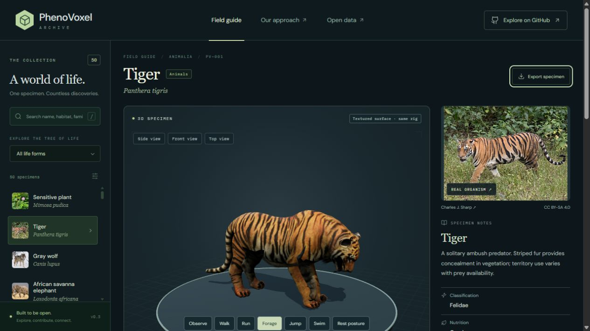

Version **0.6.50** moves the broad gulp-feeding pouch forward beneath and between the jaws of the existing blue whale and humpback. Outward lower-jaw bowing, front-leading expansion, attached longitudinal pleat relief and rounded mouth edges improve the same credited skins. [Sixty individually inspected final views, 24 actual earlier-public views and scientific comparisons](rorqual-anterior-v0650.html) show the change and remaining texture/oral-anatomy limits. All 347 full local software checks passed before final report wording edits; these are not biological validation. A newly inspected whole NPS humpback photograph has a specific public-domain catalog grant. Geometry, timings, optics and inner-mouth structures remain partly stylized and unmeasured; flow, prey retention and swallowing are unfinished. No additions: 308 public records, 242 remaining to 550. Scheduled work remains off.

Version **0.6.49** adds staged lunge-feeding exteriors for the existing blue whale and humpback on their same credited textured skins. Head elevation, lower-jaw opening, pouch expansion, closure and slower contraction are inspectable with six stage controls. [Sixty actual final compiled views, eighteen earlier public views, scientific references and limitations](rorqual-feeding-v0649.html) document the correction. Delivered models/images are unchanged; the blue whale retains its elongated grey-blue body and small posterior fin. These are unmeasured authored studies, without solved flow, prey retention, tongue inversion, swallowing or physiological validation. Other species' pending mechanisms remain listed in the [action inventory](behavior-capabilities-v0649.html). No new species:308public records,242remaining to550. Scheduled work is off; this release follows a direct human instruction.

Version 0.6.48 corrects the blue whale's overly deep body, conspicuous fins and abrupt white belly field. [Actual before/after views and scientific-reference scopes](blue-whale-proportions-v0648.html) show a longer grey-blue body on the same credited surface. The finite movement remains unmeasured; complete swimming/feeding and optical realism are unfinished. No new species: 308 public records, 242 remaining to 550.

Version **0.6.47** adds the blue whale and a [complete audit of the human's 150-item specimen list](iconic-specimens-v0647.html). [Twenty-four actual final whale views and the source-linked report](blue-whale-review-v0647.html) cover selected body, rostrum, eye, pectoral, atlas and finite same-model motion corrections. After deployment: **308 species, 242 remaining to 550**. The list has 147 species concepts plus one hybrid: 20 species were already public and one of 127 potential additions is initially reviewed here; **126 remain nominations**. Unmeasured proportions, natural optics, mouth anatomy and complete movement/feeding mechanisms remain unfinished. This is not photorealism or independent biological validation. The release history below retains its original counts and scopes.

Version 0.6.44 individually revises all 16 existing Anthozoa records (11 anemone profiles and five corals/sea fans) and the box jellyfish **Chironex fleckeri**. Smoother unequal tentacles, distinct oral/body forms, attached original pigment/relief and finite same-surface local movements replace coarser repeated exteriors. [The scientific report](anthozoa-review-v0644.html) contains 153 individually inspected final compiled views and 102 actual earlier public views on 51 credited comparison sheets. Columns, colony packing, fine anatomy and optics remain partly stylized and unmeasured; this is not completed photorealism or biological validation. All final optical checks used software compatibility, with no final WebGL review. Zero additions: 307 public species, 243 remaining to 550.

Version 0.6.43 revises existing **Rhizostoma pulmo** with separate three-winged oral regions and upper scapulets, longer translucent terminal clubs, finer original cream/gold/violet surface fields and a finite same-model regional flexion study. [Actual scientific comparisons and remaining defects](rhizostoma-review-v0643.html) document24final compiled states and9earlier public states on17credited sheets. Shapes, optics and rhythms remain partly stylized and unmeasured; propulsion, feeding, canals and physiology remain unfinished. Zero additions:307records,243remaining to550.

Version 0.6.42 refines existing **Cotylorhiza tuberculata**: rounded branching oral axes, finer attached folds, varied white/violet expanded clubs, original bell/body pigment and a finite same-model local movement study with a comparatively fixed central dome. [Actual scientific comparisons and residual limitations](cotylorhiza-review-v0642.html) document24final compiled views and9earlier public views on17credited sheets. Source-identified primary photography is separately credited and preserved whole. Natural tissue optics, fine folds, canal continuity, feeding and propulsion remain unmeasured or unfinished; no independent biological validation or accuracy percentage. Zero additions:307records,243remaining to550. Earlier release sections below are historical.

Version 0.6.41 corrects the existing **Cassiopea xamachana** oral field: four selected pairs of branching axes, finer irregular frills, curved foliaceous appendages, original brown-ivory spatial pigment and a supported finite movement study on the same surfaces. [Inspect 24 final compiled views, nine earlier public views and scientific-source scopes](cassiopea-review-v0641.html). Full local regression passed 288 software checks; these are not biological validation. Geometry, optics, timing, mouthlet/canal continuity, feeding currents and adhesion remain unmeasured or incomplete. Zero species added: 307 public records, 243 remaining to 550.

Version 0.6.40 individually revises the collection’s ten medusa species and three related floating colonies. [The source-linked report and actual comparisons](jellyfish-review-v0640.html) distinguish authored exteriors from measured organisms. Bells, oral tissues, tentacle groupings and colony floats now have different selected forms; the moon-jelly artist payload is retained. The compatibility renderer now respects RGBA vertex opacity. Final rendering coverage and residual defects are recorded explicitly. These remain partly stylized, unmeasured studies with incomplete swimming/feeding mechanisms. No new species: 307 public records, 243 still needed for 550.

Version 0.6.39 records individual visible shape, surface and process issues for all 23 Arthropoda, 30 Cnidaria and 46 Fungi in [385 actual baseline views and 33 credited comparison sheets](group-realism-review-v0639.html). The first three fungal exterior corrections replace repeated dishes/umbrellas/open sheets with selected closed caps, short supports and exposed gills or pores; [51 actual final views and 12 separate compatibility views](fungal-exteriors-v0639.html) retain explicit limitations. Mature-body resizing is withdrawn for those records. They remain partly stylized and unmeasured; 96 requested records await deeper corrections. Total remains 307, with 243 additions still needed for 550.

Version 0.6.37 corrects the existing great pond snail adult shell, collar/body, tentacles and finite partial glide, preserving the preceding octopus work. [Review 27 final compiled views, primary sources, authentic reference photo and residual limits](mollusca-review-2026-10-26-lymnaea.html). Geometry, materials and timing remain authored/unmeasured. Complete ciliary/mucus locomotion and photorealism remain unfinished. 307 species; zero additions in this release.

> v0.6.36 revises selected octopus arms, joined external body, numerical skin and finite support/reach mechanisms. [Actual comparisons and scientific limitations](corrections-v0636.html). No new species or completed biological validation;307records and243further species remain.

> v0.6.35 improves selected octopus external sucker/funnel anatomy, inspection visibility and retained-surface support/reach studies. [Actual comparisons, authentic references and residual limitations](corrections-v0635.html). The archive remains 307 records; full realism, physiology and 243 additions are unfinished.

> v0.6.34 improves the garden-snail adult external form and adds attributed study-frame captures. [Scientific comparison and limitations](corrections-v0634.html). The archive remains307 records; partial mechanisms and243 further species are unfinished.

> v0.6.33 follows the all26 Mollusca body pass with corrected anatomical links and77 actual regional detail views. [Both reviews and remaining defects](corrections-v0633.html). Models remain partly stylized, unmeasured and incompletely implemented.

> v0.6.32: all 26 existing molluscs received initial body, shell, surface and limited same-model motion corrections. [100 final views and 26 individual limitations](mollusca-review-2026-10-26.html). Models remain partly stylized and unmeasured; no independent biological validation. Zero additions; 307 public records.

> v0.6.31: corrected intersecting far-side cheetah paws across the same-model neutral/head-turn/stepping studies. [47 actual views and limitations](cheetah-clearance-review-2026-10-25.html). Zero new species;307records,5/50new large animals and243species remaining to550.

> v0.6.30: cheetah body, surface and bounded walking correction. After verified deployment: 307 public species, 5 of the 50 requested new large animals. [Individual report](cheetah-review-2026-10-25.html), [36 actual comparison views](corrections-v0630.html), [movement and development inventory](behavior-capabilities-v0630.html). There are 45 requested large animals and 243 species to 550 still to add. Models remain unmeasured; 162 declared mechanisms are unavailable.

> v0.6.29 initial jaguar study:306 records after verified deployment. This human-requested50-large-animal pass has admitted4;46remain. [Individual report](jaguar-review-2026-10-25.html),[current register](behavior-capabilities-v0629.html),[release](corrections-v0629.html). Unmeasured,partly stylized models and159unavailable declared mechanisms remain; no independent biological validation.

# PhenoVoxel Archive

Historical v0.6.28 — 305 species. This release adds the first **3 of 50 requested large animals**: killer whale, whale shark and white shark. It includes 39 actual final comparison states, six credited screenshot sheets, repaired shark materials and same-surface swimming studies. **47 requested large animals and 245 species toward 550 remain.** These are initial unmeasured educational studies, without independent biological validation. [Reviews, sources and limitations](https://www.canopico.tech/phenovoxel/corrections-v0628.html) · [Complete movement/development register](https://www.canopico.tech/phenovoxel/behavior-capabilities-v0628.html). All 153 unavailable mechanisms in the previous 302 records remain unresolved; three new feeding mechanisms are also unavailable. Earlier release sections below are historical.

**An open, evidence-linked 3D encyclopedia of life.** Explore a specimen in the center of a research desk, inspect its anatomical features, read its scientific context, and play appropriate biological processes.

Version **0.6.12** includes **250 nominal species-level records and licensed organism photographs/micrographs**, 22 retained artist models and 228 original reference reconstructions. The [current model-quality register](https://www.canopico.tech/phenovoxel/reviews/2026-10-18-quality/index.html) records 60 individual animal comparisons, 37 initial corrections and 905 actual rendered samples; 190 current-pass comparisons remain pending. The latest brittle-star/feather-star bodies retain distinct arm, spine, pinnule and cirrus structures across partial local flexion. See [the scientific-review report](SCIENTIFIC-REVIEW-2026-10-18.md). No biological accuracy percentage, physiological simulation or independent specialist validation is established.

Navigation now groups species by domain, kingdom, phylum/class and selected animal clades, with full binomials as the primary labels. Alphabetical siblings do not imply evolutionary ages. ITIS supplies 190 exact name strings, of which 188 are valid/accepted and two conflict with the botanical authority retained here. Three bacterial backbone links resolve to informal genome clusters rather than whole-species concepts; their occurrence maps are withheld pending resolution. ITIS is Smithsonian-partnered; this is not equivalent to a Smithsonian collection determination. All name decisions remain downloadable in `taxonomy-audit.json`.

Cumulative reporting mix remains 103 Animalia / 72 Plantae / 36 Fungi / 25 legacy Protista / 14 legacy Monera (11 Bacteria and 3 Archaea). October 18 added 19 animals, 16 plants, 8 fungi, 5 microeukaryotes and 2 bacteria. Legacy Protista/Monera are reporting categories, not modern monophyletic kingdoms.

Version 0.5 begins the requested full-collection correction pass with an individual [50-specimen screenshot and issue review](https://canopico-world.github.io/PhenoVoxel-Archive/reviews/2026-10-14/index.html), 520 baseline samples and 108 corrected plant samples. All ten plants receive initial organ/surface refinements: curved leaf laminae and original numeric venation, local Mimosa closure, a rosette flytrap, open lower pitchers, radial sunflower florets, one retained Arabidopsis source plant, clustered ginkgo fans, opposed redwood foliage, restored original oak laminae on retained artist wood, cupped lotus leaves and a basal fern crown with continuous unfurling. Growth stays anchored and holds at maturity. These are reviewed software/visual corrections; all geometry, materials, developmental timing and biomechanics remain unvalidated. Tiger/wolf receive the next initial correction pass: supported quiet paws, nearer folded wolf hind limbs, near-level sitting muzzles, curved closed wolf lids using its source atlas, and a tiger jump whose lift survives floor correction. Honey bee now has supported six-leg walking, finer worker surface cues and folded/unfolded same-model wing pairs. Myxococcus gliding stays on the substrate; Sulfolobus twitching uses separate retracting adhesion pili, while swimming rotates its distinct archaellum. Chimpanzee receives denser surface-area-sampled coat hair and a supported relaxed seated-hand study. Elephant/giraffe Walk uses corrected lateral footfall order and supporting sole/hoof regions; elephant source relief is reduced. Kangaroo, bear and rabbit receive source-derived fine coat attachments and corrected support/recovery phases. Rabbit retains its pied artist phenotype, receives fur-covered sole atlas corrections and now has a correctly directed Front camera. Fox receives conservative source-derived trunk/tail smoothing, fine coat cues and separate Walk/Trot support phases. Owl receives original contour-feather cues and held visual-search poses on its retained perch. Full owl flight and fox pouncing remain pending. Dolphin receives mild countershading and retains its creator whole-body swim cycle across Swim, slower Forage approach and Quiet swim. Humpback keeps individual source markings while body pitch joins the tail wave and flippers hold trim during Swim. Feeding, water dynamics and physiological sleep remain absent. Eagle receives source-colored contour cues, flight-leg proxies and a held glide posture; the distorted perched Rest fold is withdrawn and marked pending. Penguin receives corrected source/camera axes, separate foot support/recovery and belly-down, forward-aligned swimming. Source scan color and individual tissue details remain unverified. Green turtle receives quieter pigment, surface-seated ocular cues, an authored five-stage stroke and held rear-flipper trim/Glide on its retained sculpt; feeding, scute identity and fluid mechanics remain unverified. The other 22 records have documented individual issues awaiting correction. The review includes 616 after-correction samples. Camera buttons now support closer inspection.

Version 0.5.4 adds automatic compatibility 3D when WebGL is unavailable. It rasterizes the same source meshes, textures, skin joints, morph targets, instances and authored motions using canvas; camera, anatomy links and model exports remain available. Compatibility mode has reduced frame rate/resolution and approximate lighting, without GPU normal maps, shadows or refraction. Browsers with functioning WebGL keep the existing full renderer. Resource disposal, explicit pose-frame painting, camera recovery and native anatomy links are also improved. Source image bitmaps are released after a specimen is discarded; an export pins its source resources until serialization finishes. These changes do not validate organism geometry or biomechanics.

Version 0.6.1 adds [50 individually reviewed draft reconstructions and 338 actual side/front/top/process samples](https://www.canopico.tech/phenovoxel/reviews/2026-10-16/index.html): 19 animals, 16 plants, 8 fungi, 5 microeukaryotes and 2 bacteria. Cumulative reporting totals are 64 Animalia / 41 Plantae / 21 Fungi / 15 legacy Protista / 9 legacy Monera. New structures include paired pinnulate crinoid arms, basal spine flanges, oral tentacle crowns, palmately lobed leaves, bilabiate flower cues and hollow fruit bodies. All 58 software checks pass. Forty-seven records offer partial appendage or mature-form size studies; feeding in Clypeaster and division in both bacteria remain unavailable. Genus-only Euplotes imagery, stained bacterial imaging, a beach test reference and source retrieval limits are explicit. These are authored, unvalidated morphology studies, not photoreal scans, measured biological development or independently validated biomechanics. The original correction queue remains open.

Version 0.6.0 adds [individual review records and 330 actual rendered samples for all 50 new species](https://www.canopico.tech/phenovoxel/reviews/2026-10-15/index.html). Real images retain creator terms and delivered checksums. Accepted species identifiers are deduplicated against the original collection. Forty-five new entries expose partial same-surface process studies; five unsupported mechanisms stay unavailable. Mature-form size interpolation does not model ontogeny. Neither visual review nor 55 software checks establishes scientific accuracy, photorealism or validated biomechanics. Each entry lists its remaining shape, texture, stage and movement inaccuracies. The older correction queue remains unresolved.

The [October 15–24 expansion plan](EXPANSION.md) schedules 50 additions per day toward 550 total, with final rounded targets 220 Animalia, 165 Plantae, 83 Fungi, 55 legacy Protista and 27 legacy Monera. Modern domains remain separate. Local automation requires the computer and desktop app to stay running; incomplete work must be recorded honestly, without duplicate or filler records.



Clownfish now retains its original textured surface while an independently authored body, tail and paired pectoral-fin rig plays Swim, Forage and Escape. The rig is generated in the viewer; the source GLB remains unchanged. Qualitative fin use is linked to Marcoux & Korsmeyer (2019), while trajectories and timing remain unvalidated.

Version 0.4 adds wolf/tiger Sit and Sleep postures with folded limbs and paw contact; corrected solid elephant skin rendering; species-specific whale, turtle, monarch, eagle and penguin articulation; improved giraffe/elephant/rabbit motion; and revised botanical, fungal and microbial anatomy. All 50 rendered forms were reviewed. Partial actions explain their coverage and unsupported behaviors are marked pending. Movements remain source-guided qualitative studies, not validated biomechanics. See [IMPROVEMENTS.md](IMPROVEMENTS.md) for provenance, checks and remaining priorities.

Version 0.4.1 corrects overlapping wolf facial shells and replaces the earlier flat-toe repose rule with separate wrist/digit orientation and torso/limb support constraints. Bear now retains one textured surface across articulated Walk, Running walk, Forage search and quiet standing Rest. A 15-joint viewer rig preserves source files and credits; all motion is unvalidated. The next release extends kangaroo and chimpanzee articulation.

Version 0.4.2 adds a standing kangaroo artist derivative with paired hindlimb Hop, tail-assisted Slow walk, a lowered Forage posture and upright Rest. The former resting scan remains a credited legacy file. Chimpanzee has a shared 22-joint limb/digit rig, a smoother surface and authored short fur across Knuckle walk, supported search and seated Rest. Anatomy markers follow their posed limbs/head/tail. All timing, morphology and biomechanics remain unvalidated; ingestion, grip forces and physiological sleep are not simulated. Owl wing/foot movement remains the next priority.

## Run locally

Install [Node.js](https://nodejs.org/) 22.12+ or 24 LTS, then:

```sh
npm ci
npm run dev
```

Open **http://127.0.0.1:5173/**. For a production build:

```sh
npm run build
npm run preview
```

No API keys, account, backend, or external model downloads are required. Photographs, geometry, land outlines and occurrence-count snapshots are bundled. Live GBIF density tiles, scientific links and optional Google Fonts require internet. A tile outage is shown explicitly; it does not indicate absence of a species.

Wolf and tiger now play **walk, run, forage and rest on the same textured mesh in one local viewer**. No Sketchfab account or embedded viewer is needed. The tiger retains Amil’s original surface and run cycle. The wolf uses the openly reusable textured model credited to victory_mirosya (currently Paleo Modelist), with creator feeding clips and authored gait/posture studies. Source clips and authored motion are labeled separately. The earlier igor-lir wolf was replaced because its reusable download required sign-in.

22 active licensed artist models and one legacy kangaroo GLB are bundled, with source links, authors, licenses and SHA-256 hashes in `model-assets.json`. 4 active models use authored materials instead of image textures. The other 228 records use original reference-guided surfaces. Static models retain their surface when a behavior is selected; several still need a complete species-specific motion rig. Do not interpret a tilted static surface or an illustrative rig motion as a recorded behavior.

## Explore

- Search full scientific names, common names, clades, orders, families and habitats; filter by reporting group.
- Drag to orbit and scroll to zoom the central 3D specimen.
- Inspect authentic reference photos and original specimen captions, with visible author/license credits.
- Switch lateral, anterior and dorsal camera views; compare the model with its reference.
- Explore recorded geographic density by period and follow country counts to GBIF source records. These maps are not native-range or abundance estimates.
- Select numbered anatomical labels and read their explanations.
- Play species-appropriate actions: walking, jumping, swimming, foraging, escape, sleep posture, leaf folding, trap closure, budding, growth, and microbial movement.
- Pause, change playback speed, inspect wireframes, hide labels, reset the camera, or expand the viewer.
- Read overview, anatomy, ecology, taxonomy, evidence, and reusable data on one page.
- Export a species JSON record, the full archive JSON, a species-index CSV, BibTeX citations, or static current-pose GLB geometry with model attribution.
- Link directly to a species, for example `/#mimosa-pudica` or `/#panthera-tigris`.

## The first 50

| Navigation group | Records | Examples |
| --- | ---: | --- |
| Animals | 25 | Tiger, elephant, axolotl, honey bee, moon jelly |
| Plants | 10 | Sensitive plant, flytrap, sunflower, ginkgo, male fern |
| Fungi | 5 | Fly agaric, oyster mushroom, budding yeast |
| Microeukaryotes | 5 | Amoeba, Paramecium, Euglena, Chlamydomonas, Physarum |
| Bacteria | 3 | E. coli, Bacillus subtilis, Myxococcus xanthus |
| Archaea | 2 | Halobacterium salinarum, Sulfolobus acidocaldarius |

**Groups are navigation labels, not a universal kingdom system.** In particular, Microeukaryotes is not a kingdom. The taxonomic panel records the GBIF backbone's classification; green algae can appear in Plantae despite their navigation grouping.

## Scientific scope

The written records are concise, original summaries linked to institutional species accounts and research papers. All 50 names matched species-level GBIF backbone entries during preparation on 2026-10-13. Behavioral references are attached to each process. Primary research, institutional natural-history accounts, and explicitly marked preprints are distinguished in the data.

**The models and animations are educational reconstructions, not validated scientific simulations.** Wolf and tiger have the same textured mesh across their four principal behavior modes. The remaining species have received a surface upgrade, with varying detail and animation coverage. Several static artist models still need full rigs; microscopic internal structures and developmental loops are conceptual. Proportions, surfaces, label locations, postures, gaits, trajectories, and timing remain approximate. Playback speeds are interface settings, not organism speeds. Growth loops compress time. Static GLB exports do not contain motion recordings. No force, metabolism, ecological interaction, or population prediction is computed.

All records have `review.status = "draft — expert review needed"` and `animationValidated = false`. They can seed an educational application or research-data infrastructure; use source literature and measured, expert-reviewed replacements for quantitative research.

Species concepts need care: the starter accounts for giraffe, barn owl, common octopus, moon jelly, and fly agaric may use broad or historically applied concepts. Microbial behavior can depend on strain and conditions. The archive makes these limits visible and does not supply current conservation categories or medical/foraging advice.

See [SCIENCE.md](SCIENCE.md) for provenance and a path to validation, and [CONTRIBUTING.md](CONTRIBUTING.md) to add reviewed records, measurements, or species-specific models.

## Reuse the database

[`species.json`](species.json) is the canonical, versioned dataset. [`schema.json`](schema.json) defines its structure. Records contain stable IDs, scientific and common names, taxonomy identifiers, habitat/range/nutrition summaries, anatomical notes, supported process IDs, source links, model/review metadata, photographic provenance, and occurrence snapshots. [`media.json`](media.json) is the photographic attribution manifest; [`atlas.json`](atlas.json) contains exact GBIF queries and dated count/country facets. See [`ASSET-LICENSES.md`](ASSET-LICENSES.md) before reusing images or external data, and [`IMPROVEMENTS.md`](IMPROVEMENTS.md) for ongoing work.

```js
// Node.js: read the archive without launching the viewer.
import { readFile } from 'node:fs/promises';
const archive = JSON.parse(await readFile('species.json', 'utf8'));
const tiger = archive.species.find(s => s.id === 'panthera-tigris');
console.log(tiger.behaviors, tiger.sources);
```

Direct GitHub data access:

```text
https://raw.githubusercontent.com/canopico-world/PhenoVoxel-Archive/main/species.json
```

Use a commit hash in place of `main` to pin a reproducible version. There is no hosted query API in this release; the JSON is the open database snapshot. Process IDs are stable within this schema version. When a species concept changes, retain the old identifier with migration notes rather than silently redefining it.

## Source maintenance and checks

```sh
npm test
node research.mjs
```

Tests check catalogue records and the foundational 50 species, source-ID integrity, biological action applicability, taxonomy/family consistency, and finite model transforms for every supported animation. `research.mjs` refreshes taxonomic matches and checks source URLs; it updates data/audit files, so review its diff before committing. HTTP success is not scientific validation. Source text is cached under ignored `research-cache/` and is not redistributed. Kew blocked direct automated retrieval; those pages were read through web tools and that distinction is recorded.

## Architecture

Vanilla JavaScript, Vite, Three.js, Leaflet and Lucide. Original geometry and externally licensed assets have separate manifests. The app is static and can be served by any static host. `models.js` authors geometry and educational poses; `viewer.js` manages 3D interaction; `app.js` renders navigation, science panels, and exports. `species.json` remains independent of the UI.

## Licenses

- Code and original procedural geometry: [MIT](LICENSE).
- Original dataset summaries and metadata: [CC BY 4.0](LICENSE-DATA.md). Attribute **PhenoVoxel Archive contributors**, the repository, and the version; retain citation provenance and indicate changes.
- Referenced papers, accounts, photographs, and databases retain their own licenses. Full scientific articles are not bundled. Photographs/micrographs are included under their recorded asset licenses; bundled artist models retain their creator licenses. See ASSET-LICENSES.md.

This project is not affiliated with the source institutions or with any film franchise.

Version 0.4.3 adds quiet wolf lip/jaw closure and head-region refinement while retaining teeth, source UVs, source feeding and all body/limb geometry. The museum owl has a 16-joint perched rig with connected partial wing opening, head search and gentle foot adjustment on one retained textured scan. Full flight remains pending because an experimental horizontal-flight reconstruction distorted the body and was rejected. The mounting block is labeled as part of the taxidermy scan. All movements remain unvalidated.

Version 0.4.7 improves tiger quiet paw/claw postures and adds a slight supported torso lean and source-atlas eyelid covers in Sleep posture. It preserves the original eye/texture/skin and creator run. The sixteen artist claws fold dorsally in quiet states; dewclaws and physiological mechanisms remain unmodeled. Automatic camera fitting now keeps the visible posed organism inside narrow or wide viewers, above the action controls, including anatomical views and growth bounds. Hidden or unreferenced scan geometry does not affect framing.

Version 0.4.8 replaces the zebrafish’s coarse stripe edges and incomplete rigid fins with an original continuous surface, five longitudinal mesh-color bands, seven fin membranes and a shared twelve-joint rig. Swim, Forage search and Escape illustrations preserve the same surfaces; static GLB exports retain skinning, vertex pigmentation, sources and unvalidated-status metadata. Individual identity, calibrated motion, forces, feeding and physiological escape remain unmodeled.

Version 0.4.9 upgrades turtle, crocodile, axolotl and red-eyed tree frog surfaces and same-model articulation. Turtle retains the artist sculpture with original scute/skin pigments and additional foreflipper sweep/twist controls. Crocodile now uses a credited CC BY 4.0 textured generic artist surface with grounded limb motion and a lateral tail rig; Nile identity is unverified. Axolotl has smoother irregular wild-type mottling, integrated grooves, fuller head and finer gills. Tree frog has continuous smooth skin, folded limbs, terminal pads, staged jumping and tucked translucent-eye rest. All geometry, timing, taxonomic interpretation and biomechanics remain unvalidated.

### Continuous earthworm surface (0.4.10)

The original earthworm reconstruction now has a closed continuous pigmented skin instead of separate rings, shallow segment furrows, a dorsal saddle clitellum and small paired setal tips. Crawl and slower Forage keep the same geometry while a posterior-traveling strain wave couples elongation/narrowing with shortening/thickening. The cycle remains in place; it is a qualitative hydrostatic illustration, not a friction/contact solver or measured displacement. The authored 120 segments, color, maturity, specimen identity and physiology remain unvalidated.

Primary references linked in the record are Quillin (1999), Kurth and Kier (2014), and James et al. (2010); the old ADW account returned 404 and was removed as evidence. The existing Michael Linnenbach photograph remains separately credited CC BY-SA 3.0. Original geometry, mesh colors and numeric microrelief are MIT and use no source photographic pixels. Downloads preserve the current static pose and provenance, not a recorded animation.

October 17 review: [50 new draft reconstructions and 270 actual render samples](https://www.canopico.tech/phenovoxel/reviews/2026-10-17/index.html). Cumulative reporting mix: 84 Animalia, 56 Plantae, 28 Fungi, 20 microeukaryotes, 12 prokaryotes. These are authored, unvalidated morphology studies. Twenty new mechanisms remain unavailable; uniform size interpolation is not biological development.

October 18 review: [50 individual issue records and 286 actual side/front/top/process captures](https://www.canopico.tech/phenovoxel/reviews/2026-10-18/index.html). Thirty-four partial same-model studies include 16 plant size interpolations, 9 bell-outline pulses, 7 anemone/coral appendage gestures and 2 ciliate shortening/coiling studies. Sixteen feeding, decomposition or division mechanisms remain unavailable. These are authored, unvalidated morphology drafts with per-species shape, texture, stage and movement limitations; no quantitative biomechanics or photoreal scans are claimed. Earlier 200 records and retained wolf/tiger meshes/actions are preserved.


## Staged plant development and abalone distinctions · 0.6.12

Two staged plant illustrations now separate seed/cotyledon, true-leaf, bud and flower structures; seventy other unsupported land-plant development actions are withheld. Red and European abalone have distinct selected shell domes and variable open-pore examples, with corrected grazing wording and a shell-only reference label. See the [October 24 source, screenshot and limitation report](https://www.canopico.tech/phenovoxel/review-2026-10-24.html). These are four educational reconstruction corrections, not independently validated models. The collection remains at 250 records; the 550-record expansion target is unfinished and fifty local expansion drafts remain unpublished.


## Historical deadline reconciliation — v0.6.13, October 24

The public catalogue remains **250/550 records**. All fifty saved expansion drafts were visually screened in **207 actual final rendered views** and withheld for major realistic-shape, texture, source-scope and movement corrections. The separate candidate passed132 software checks; passing code does not establish biological realism. Fifteen candidate gymnosperm scaling actions are disabled and the original draft plus the integrated reviewed branch are preserved locally.

[Read all fifty individual findings and screenshot comparisons](https://www.canopico.tech/phenovoxel/final-review-2026-10-24.html) · [Download the report](https://www.canopico.tech/phenovoxel/final-review-2026-10-24.json) · [Scientific review source](FINAL-EXPANSION-REVIEW-2026-10-24.md).

Missing300: Animalia117, Plantae93, Fungi47, legacy Protista30 and legacy Monera13. Fifty have saved drafts; another250 have none. No 90% accuracy, physiological simulation or independent expert validation is claimed. The October15–24 schedule ends after the final reconciliation; no further automated additions after October24. The earlier v0.6.12 plant and abalone fixes remain intact.


## v0.6.14 — edible crab correction after renewed expansion request

One of the fifty previously withheld species, Cancer pagurus, now has a revised lobed carapace, original granular cuticle surfaces, eight articulated fixed-length walking legs and same-model supported movement. All42 final captured states were inspected across five comparison sheets. The original250 records are unchanged. The collection reaches251 only after this release is deployed;49 saved drafts remain withheld and299 species remain to reach550. Authored movements and materials remain unmeasured, with partial anatomy and no independent validation. [Read the individual source, screenshot and limitation report](https://www.canopico.tech/phenovoxel/crab-review-2026-10-24.html).

The subsequent human request renewed correction and expansion work toward550 beyond the completed October15–24 schedule. Only individually corrected, rendered and reviewed additions may enter a later release. The earlier report remains a dated snapshot, not the current count.


## v0.6.15 — common shore crab correction

Carcinus maenas now has a tapered five-toothed shell, three frontal lobes, smaller pale-fingered chelae, distinct middle/final leg proportions and retained-model supported motion.42actual final body/posture/motion views were inspected against a licensed real photo, Smithsonian SERC species account and selected primary locomotor figures. One addition reaches252records;48saved drafts remain withheld and298records remain to 550. Previous251records are unchanged. Geometry/materials and gait remain unmeasured, with partial anatomy and no independent biological validation. [Individual findings and screenshots](https://www.canopico.tech/phenovoxel/shore-crab-review-2026-10-24.html).


## v0.6.16 — Atlantic blue crab correction

Callinectes sapidus receives a broad nine-toothed shell with long lateral spines, ridged female chelae, six pointed walking limbs, distinct articulated P5 paddles and a visible female apron. Same-model walking, stationary swim-stroke study, local handling, claw opening and quiet support remain qualitative.60 actual main-viewer states plus3 views ofone actual static GLB export were inspected on9 sheets against a licensed real female photograph and scoped FAO/Smithsonian/primary evidence. One addition reaches253 after verified publication;47 drafts remain held and297 species remain to 550. Existing252 species objects are unchanged. Unmeasured anatomy/materials, partial mechanisms and no independent biological validation. [Findings and screenshots](https://www.canopico.tech/phenovoxel/blue-crab-review-2026-10-24.html).


## v0.6.17 — gazami crab correction

Portunus trituberculatus receives a distinct broad granular shell, selected three-toothed front, long lateral spines, dark mottled chelipeds with four inner meral spine cues, inner/outer carpal cues, asymmetric ridged chelae and expanded articulated P5 blades. Same-model supported walking, a stationary paddle-loop study, local handling, finger opening and quiet support remain authored and unmeasured. The failed FAO link was replaced with a verified official full-volume PDF; selected actual key/species figures and Chen et al.2022 biological observations were inspected alongside Almandine’s licensed real photograph. 60 final viewer states and three views of one static export are recorded on nine sheets. Four of fifty withheld drafts have initial corrections; this release reaches 254 after verification, with 46 drafts held and 296 species missing from 550. Prior 253 species objects are unchanged. The Naturalis frontal wording discrepancy and incomplete anatomy/optics/motion remain disclosed, without independent validation. [Report and screenshot comparisons](https://www.canopico.tech/phenovoxel/gazami-review-2026-10-24.html).


## v0.6.18 — three individual crab corrections

Necora puber, Eriocheir sinensis and Hemigrapsus sanguineus receive distinct corrected bodies, selected cuticle/setae fields, articulated chelae and authored supported locomotion on the same retained models.144 final actual comparison states on 18 sheets, authentic licensed photographs and scoped primary/institutional sources support an initial educational correction. Fine anatomy, optics, biological timing and physiology remain unmeasured/unvalidated. Artificial shell folds and coarse pigmentation detected in top-view review were corrected before final captures.257 public records after verification;43 saved drafts remain withheld and293 records remain to 550. Prior254 species objects unchanged. [Release register](https://www.canopico.tech/phenovoxel/corrections-v0618.html). Next: Grapsus grapsus.


## v0.6.19 — five individual coastal-crab corrections

Grapsus grapsus, Ocypode quadrata, Leptuca pugilator, Pinnotheres pisum and Maja brachydactyla have distinct bodies, numerical cuticle/setae fields, articulated limbs/chelae and scoped same-model motion.240 final actual views on 27 sheets; source access, corrections after rendered comparison and residual anatomy/optics/motion limitations recorded per species.262 public records after verification;38 saved drafts held;288 missing to 550. [Individual review register](https://www.canopico.tech/phenovoxel/corrections-v0619.html). No independent biological validation, physiological simulation or measured accuracy percentage.


## v0.6.20 — three individual clawed-lobster corrections

Homarus gammarus, Homarus americanus and Nephrops norvegicus have distinct bodies, numerical cuticle/setae fields, articulated limbs/chelae and scoped same-model motion.165 final actual views on18 sheets; source access, corrections after rendered comparison and residual anatomy/optics/motion limitations recorded per species.265 public records after verification;35 saved drafts held;285 missing to550. [Individual review register](https://www.canopico.tech/phenovoxel/corrections-v0620.html). No independent biological validation, physiological simulation or measured accuracy percentage.


## v0.6.21 — two individual spiny-lobster corrections

Palinurus elephas and Panulirus versicolor receive distinct spined carapaces, grooved/spotted versus smooth/banded abdomens, unarmed versus four-spined antennular plates, long tapered antennae and ten supported walking limbs. 110 final actual views on12 credited sheets compare body, surface and scoped motion with authentic photographs and selected FAO/Naturalis/SERC evidence. 267 records after verification;33 saved drafts held;283 missing to550. [Individual register](https://www.canopico.tech/phenovoxel/corrections-v0621.html). Fine anatomy, optics and biomechanics remain incomplete/unmeasured, without independent validation.


## v0.6.22 — three individual prawn and hermit-crab corrections

Palaemon serratus, Crangon crangon and Pagurus bernhardus receive distinct bodies, original cuticle surfaces and retained support/partial appendage articulation.149 actual final views on 19 credited sheets compare each body and available action with authentic photographs and selected authoritative/primary evidence.270 records after verification;30 saved drafts held; 280 missing to 550. [Individual register](https://www.canopico.tech/phenovoxel/corrections-v0622.html). Fine anatomy, optics and biological dynamics remain incomplete/unmeasured; no independent validation or accuracy percentage.


## v0.6.23 — four individual conifer corrections

Pinus sylvestris, Pinus pinea, Picea abies and Abies alba receive distinct branching/needles, original continuous bark and selected cone surfaces.98 actual final views on14 credited sheets.274 records after verification;26 saved drafts held;276 missing to550. [Individual register](https://www.canopico.tech/phenovoxel/corrections-v0623.html). Full seed-to-tree organ development remains unavailable; no mature-crown resizing. Fine morphology, tissue optics and environmental mechanics remain incomplete/unmeasured.


## v0.6.24 — eleven individual gymnosperm corrections

Eleven gymnosperms receive distinct whole habits or explicitly selected organs, original numeric foliage/woody surfaces and reproductive studies, with same-model external branch/rachis deflection.176 actual final views on33 credited sheets.285 records after verification;15 saved drafts held;265 missing to550. [Individual register](https://www.canopico.tech/phenovoxel/corrections-v0624.html). Full seed-to-tree organ development remains unavailable; no mature-crown resizing. Fine morphology, tissue optics and environmental mechanics remain incomplete/unmeasured.


## v0.6.25 — eight individual fungal corrections

Distinct selected fruit bodies, fertile surfaces, numeric skin relief and stationary same-model enlarged spore overlays;104 actual final views/16 credited sheets.293 records after verification;7 saved drafts held;257 missing to550. Hericium uses a new credited European photograph and withholds unreconciled broad-name occurrences. Underside mode hides the contextual platform. [Individual register](https://www.canopico.tech/phenovoxel/corrections-v0625.html). Partly stylized, unmeasured educational reconstructions; no independent validation or measured physiology.


## v0.6.26 — seven individual microscopic corrections

Distinct selected frustules/colonies and bacterial envelopes; same-model glide, external drift, colony sliding and strain-qualified polar-filament/planar-wave illustrations.91actualfinalstates/14creditedsheets.300records after verification; all46renewedforeground drafts initially corrected/published, all50originalheld drafts admitted.250additionalspecies remain. Tabellaria panel-g-only photo crops and authentic2026Rhodospirillum TEM replace misleading broad references. Specialist Bacillaria/Borrelia names and withheld occurrence associations remain explicit. [Review register](https://www.canopico.tech/phenovoxel/corrections-v0626.html). Partial unmeasured educational reconstructions; fine optical/anatomical realism and independent biological validation remain incomplete.


Version 0.6.27: two new selected ascomycete studies, individually compared with authentic primary plates in 26 final rendered states. [Reports and limitations](https://www.canopico.tech/phenovoxel/corrections-v0627.html). The count reaches 302 only after verified publication; 248 remain to 550. Model tissue optics, fine anatomy and motion remain unmeasured.


## v0.6.38 · common periwinkle adult exterior · 2026-10-26

One existing Littorina littorea corrected; zero additions. Apposed selected whorl volumes, a limited aperture recess, reflected white columellar lip, closed connected head/foot/mantle, broader supported anterior sole and two closed banded feelers replace the old envelope/primitive bodies. Same surfaces retain a bounded five-second local gesture returning to neutral. Crawling, pedal waves, mucus/traction, feeding, opercular sealing, retraction and physiology remain unfinished. [Individual source/screenshot report](mollusca-review-2026-10-26-littorina.html).

27 actual final compiled states inspected on nine credited sheets plus six actual earlier public637states on two sheets. Nine separate compatibility states inspected; fine main-shader bands/physical highlights are absent and reduced optics disclosed. Real extended head/body by Ian Manning supplements the unchanged withdrawn-animal Guttorm Flatabo photograph. Actual API photo grant, official iNaturalist4.0mapping, derivative/delivery hashes and community identification scope recorded. Original-resolution retrieval timed out; no original hash claimed. No verification interstitial bypass or primary paper figure redistribution.

These remain partly stylized, unmeasured studies. Public species count307;243remain to550.


Version0.6.45 adds an individual compass-jelly exterior correction: four curved V-section frilled oral arms, selected grouped adult tentacles, original branching bell pigment and a finite same-model contraction/recovery study. [Scientific comparisons, screenshots and limits](chrysaora-review-v0645.html). Existing307species; no additions. Tissue optics, internal anatomy, feeding and complete swimming remain unfinished.


Latest individual study: [Cyanea oral curtain, inward tentacle rows and finite regional motion](cyanea-review-v0646.html). Original attached spatial pigment and selected exteriors remain unmeasured; full swimming, feeding, natural optics and physiology are unfinished. Zero additions in this quality release; 307 records, 243 still needed for the 550 target.

The subsequent [v0.6.47 blue-whale study](blue-whale-review-v0647.html) admits one new species after 24 individually inspected compiled views, with a narrower selected body, rounder rostrum, shorter pectoral envelope, smoother artist atlas and finite same-model creator excerpt. The [complete 150-item human list](iconic-specimens-v0647.html) resolves duplicates, ambiguous common names and the London-plane hybrid without inflating species counts. After deployment this release has 308 records, 242 short of 550. Of the list's 127 potential new species, one is initially reviewed and 126 remain nominations; this is not completion of realistic modelling or biological validation. The earlier 50-large-animal pool has six admissions and 44 unresolved nominations. Plant additions still require distinct evidenced juvenile and reproductive organs; mature-model resizing is not germination.
