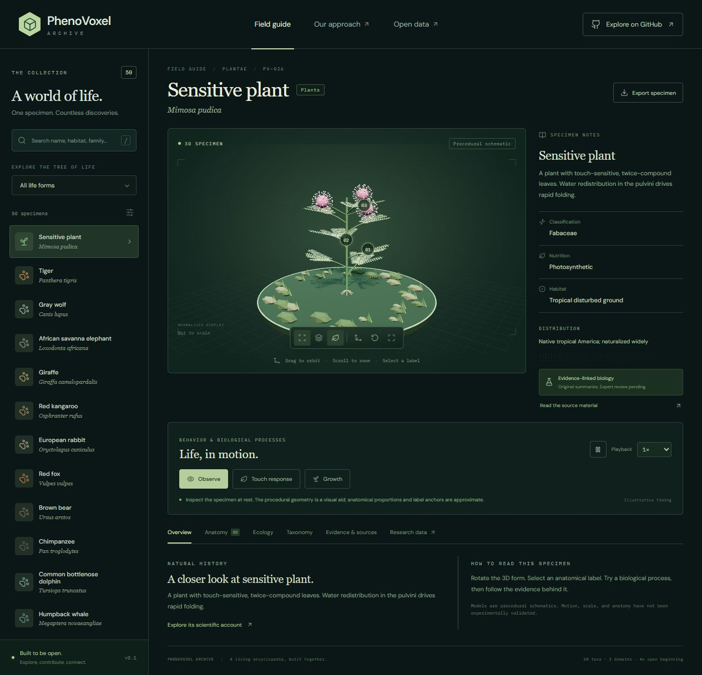

# PhenoVoxel Archive

**An open, evidence-linked 3D encyclopedia of life.** Explore a specimen in the center of a research desk, inspect its anatomical features, read its scientific context, and play appropriate biological processes.

Version **0.1.0** is an educational starter archive with **50 species-level records**, **21 procedural model families**, and linked scientific sources. Its long-term aim is coverage across the tree of life.



## Run locally

Install [Node.js](https://nodejs.org/) 22.12+ or 24 LTS, then:

```sh
npm ci
npm run dev
```

Open **http://127.0.0.1:5173/**. For a production build:

```sh
npm run build
npm run preview
```

No API keys, account, backend, or external model downloads are required. Scientific source links and optional Google Fonts require internet; bundled geometry and data run locally.

## Explore

- Search common/scientific names, families, and habitats; filter by life group.
- Drag to orbit and scroll to zoom the central 3D specimen.
- Select numbered anatomical labels and read their explanations.
- Play species-appropriate actions: walking, jumping, swimming, foraging, escape, sleep posture, leaf folding, trap closure, budding, growth, and microbial movement.
- Pause, change playback speed, inspect wireframes, hide labels, reset the camera, or expand the viewer.
- Read overview, anatomy, ecology, taxonomy, evidence, and reusable data on one page.
- Export a species JSON record, the full archive JSON, a species-index CSV, BibTeX citations, or static schematic GLB geometry.
- Link directly to a species, for example `/#mimosa-pudica` or `/#panthera-tigris`.

## The first 50

| Navigation group | Records | Examples |
| --- | ---: | --- |
| Animals | 25 | Tiger, elephant, axolotl, honey bee, moon jelly |
| Plants | 10 | Sensitive plant, flytrap, sunflower, ginkgo, male fern |
| Fungi | 5 | Fly agaric, oyster mushroom, budding yeast |
| Microeukaryotes | 5 | Amoeba, Paramecium, Euglena, Chlamydomonas, Physarum |
| Bacteria | 3 | E. coli, Bacillus subtilis, Myxococcus xanthus |
| Archaea | 2 | Halobacterium salinarum, Sulfolobus acidocaldarius |

**Groups are navigation labels, not a universal kingdom system.** In particular, Microeukaryotes is not a kingdom. The taxonomic panel records the GBIF backbone's classification; green algae can appear in Plantae despite their navigation grouping.

## Scientific scope

The written records are concise, original summaries linked to institutional species accounts and research papers. All 50 names matched species-level GBIF backbone entries during preparation on 2026-10-13. Behavioral references are attached to each process. Primary research, institutional natural-history accounts, and explicitly marked preprints are distinguished in the data.

**The models are procedural educational schematics. The animations are not validated scientific simulations.** Proportions, surfaces, label locations, postures, gaits, trajectories, and timing are approximate. Playback speeds are interface settings, not organism speeds. Growth loops compress time. Static GLB exports do not contain motion recordings. No force, metabolism, ecological interaction, or population prediction is computed.

All records have `review.status = "draft — expert review needed"` and `animationValidated = false`. They can seed an educational application or research-data infrastructure; use source literature and measured, expert-reviewed replacements for quantitative research.

Species concepts need care: the starter accounts for giraffe, barn owl, common octopus, moon jelly, and fly agaric may use broad or historically applied concepts. Microbial behavior can depend on strain and conditions. The archive makes these limits visible and does not supply current conservation categories or medical/foraging advice.

See [SCIENCE.md](SCIENCE.md) for provenance and a path to validation, and [CONTRIBUTING.md](CONTRIBUTING.md) to add reviewed records, measurements, or species-specific models.

## Reuse the database

[`species.json`](species.json) is the canonical, versioned dataset. [`schema.json`](schema.json) defines its structure. Records contain stable IDs, scientific and common names, taxonomy identifiers, habitat/range/nutrition summaries, anatomical notes, supported process IDs, source links, and model/review metadata.

```js
// Node.js: read the archive without launching the viewer.
import { readFile } from 'node:fs/promises';
const archive = JSON.parse(await readFile('species.json', 'utf8'));
const tiger = archive.species.find(s => s.id === 'panthera-tigris');
console.log(tiger.behaviors, tiger.sources);
```

Direct GitHub data access:

```text
https://raw.githubusercontent.com/canopico-world/PhenoVoxel-Archive/main/species.json
```

Use a commit hash in place of `main` to pin a reproducible version. There is no hosted query API in this release; the JSON is the open database snapshot. Process IDs are stable within this schema version. When a species concept changes, retain the old identifier with migration notes rather than silently redefining it.

## Source maintenance and checks

```sh
npm test
node research.mjs
```

Tests check all 50 records, source-ID integrity, biological action applicability, taxonomy/family consistency, and finite model transforms for every supported animation. `research.mjs` refreshes taxonomic matches and checks source URLs; it updates data/audit files, so review its diff before committing. HTTP success is not scientific validation. Source text is cached under ignored `research-cache/` and is not redistributed. Kew blocked direct automated retrieval; those pages were read through web tools and that distinction is recorded.

## Architecture

Vanilla JavaScript, Vite, Three.js, and Lucide. Procedural meshes avoid third-party model licensing ambiguity. The app is static and can be served by any static host. `models.js` authors geometry and educational poses; `viewer.js` manages 3D interaction; `app.js` renders navigation, science panels, and exports. `species.json` remains independent of the UI.

## Licenses

- Code and original procedural geometry: [MIT](LICENSE).
- Original dataset summaries and metadata: [CC BY 4.0](LICENSE-DATA.md). Attribute **PhenoVoxel Archive contributors**, the repository, and the version; retain citation provenance and indicate changes.
- Referenced papers, accounts, photographs, and databases retain their own licenses. Their full content and third-party imagery are not included.

This project is not affiliated with the source institutions or with any film franchise.
